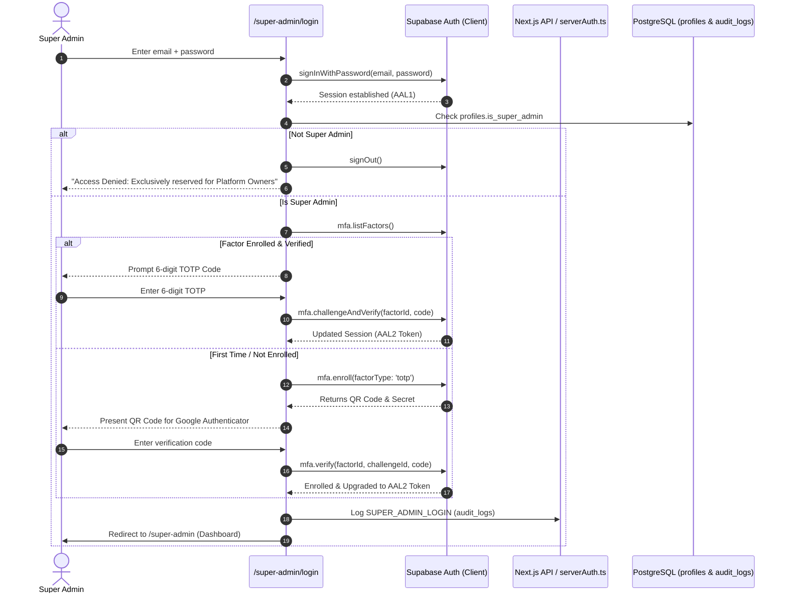

# SeyalPro — Dedicated Super Admin Authentication & Security Architecture

**Author:** Application Security Lead & Identity Architect  
**Classification:** Confidential — Platform Security Model  
**Status:** Architecture Blueprint & Implementation Specification  

---

## 1. Architectural Principles

1. **Native Supabase Auth with TOTP MFA:** Super Admin authentication builds directly upon Supabase Auth, combining primary credentials (email/password) with hardware/app-based TOTP 2-Factor Authentication (`factorType: 'totp'`).
2. **Mandatory AAL2 Assurance Level:** Administrative Route Handlers, Server Actions, and RPCs strictly require `aal2` (Authenticator Assurance Level 2). A valid password without MFA completion (`aal1`) is explicitly rejected with `403 Forbidden: MFA AAL2 Required`.
3. **Database-Authoritative Privilege:** Super Admin privileges are stored solely in the database (`profiles.is_super_admin = true`). Hardcoded email string heuristics are eliminated. Client storage, cookies, and tokens are never trusted as proof of Super Admin status.
4. **No Public Registration:** Self-registration for Super Admin accounts is disabled. Provisioning occurs exclusively via server-side bootstrap script (`scripts/bootstrap-super-admin.mjs`) using trusted service-role environment credentials.
5. **Separation of Tenant & Platform Boundaries:** Super Admin sessions are strictly isolated from normal store/tenant user workflows. Platform operations operate across tenants, but ordinary store admins can never grant, revoke, or inspect Super Admin privileges.

---

## 2. Authentication Flow & State Machine



---

## 3. Server-Side AAL2 Assurance Verification (`serverAuth.ts`)

When an administrative route handler invokes:
```ts
const auth = await authenticateRequest(request, { requireSuperAdmin: true, requireAAL2: true });
```

The verification pipeline executes:
1. **Token Cryptographic Validation:** Validates JWT against Supabase Auth service.
2. **Authoritative Privilege Check:** Queries `public.profiles` for `is_super_admin === true`.
3. **AAL2 Assurance Enforcement:**
   - Decodes JWT payload claims: `aal: 'aal2'`.
   - If `aal !== 'aal2'`, rejects with `403 Forbidden` (`{"error": "Forbidden: Super Admin access requires MFA Authenticator Assurance Level 2 (AAL2)."}`).
4. **Recent Authentication Check:** For high-impact destructive operations (e.g. password resets, tenant deletion, privilege modifications), verifies that `amr` (Authentication Method Reference) timestamp or last sign-in is within the last 15 minutes.
5. **Audit Trail Recording:** Logs every administrative call with actor, target, IP address, and user-agent.

---

## 4. Controlled Server-Side Bootstrap Procedure

Public registration of Super Admin accounts is strictly forbidden. The initial Super Admin account is provisioned via the secure administrative script:

```bash
# Executed in secure terminal / deployment environment:
node scripts/bootstrap-super-admin.mjs --email="admin@seyalpro.com" --password="<STRONG_PASSWORD>"
```

### Bootstrap Workflow:
1. Validates that `SUPABASE_SERVICE_ROLE_KEY` is present in the environment (never exposed to browser).
2. Creates the user in Supabase Auth with `email_confirm: true`.
3. Sets `is_super_admin = true`, `is_admin = true`, `business_id = null` in `public.profiles`.
4. Logs an immutable `SUPER_ADMIN_BOOTSTRAP` event in `public.audit_logs`.
5. Prompts the operator to immediately visit `/super-admin/login`, where the system forces first-time TOTP QR enrollment before any platform access is granted.

---

## 5. Privilege Protection & Database Integrity

1. **Trigger `prevent_privilege_escalation`:**
   A PostgreSQL `BEFORE UPDATE` trigger on `public.profiles` ensures that:
   - Only a caller whose session already satisfies `public.is_super_admin() = true` can change `is_super_admin` or `is_admin`.
   - Non-super-admins attempting to modify their own or another user's role flags trigger an immediate SQL exception: `Permission Denied: Only Platform Super Admins can alter administrative role privileges.`
2. **Account Takeover Protection:**
   In `/api/seed-admin` and `/api/admin-users`, user updates are blocked if the target user has `is_super_admin = true` or if the target user belongs to another business.
3. **Audit Event Coverage:**
   All privilege transitions (`ROLE_UPDATED`, `SUPER_ADMIN_GRANTED`, `SUPER_ADMIN_REVOKED`, `MFA_FAILED`) are recorded in `public.audit_logs`.
